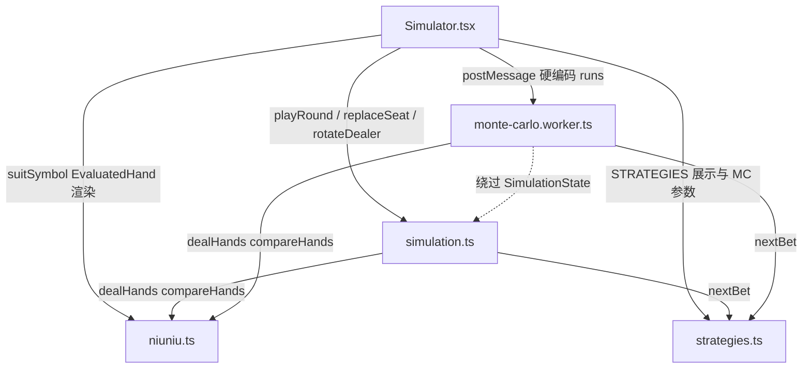

# 侦察报告：三层可插拔架构现状
日期：2026-08-10
执行者：Cursor Agent

> 证据口径：本报告仅基于磁盘源码与配置文件静态阅读；不采信 README / PRD 的功能声称。行数为 PowerShell `Measure-Object -Line` 非空行近似值。

## 一、代码库概览

### 1.1 目录与文件树（侦察范围）

仓库无 `src/`。主实现分布在 `app/`、`lib/`、`workers/`、`tests/`；另有 Cloudflare 入口 `worker/index.ts`（非蒙特卡洛 Worker）。

| 路径 | 约行数 | 角色 |
|---|---:|---|
| `app/components/Simulator.tsx` | 448 | 主 UI / 交互 |
| `app/globals.css` | 296 | 样式 |
| `app/chatgpt-auth.ts` | 72 | 模板残留，页面未用 |
| `app/layout.tsx` | 13 | 布局 |
| `app/page.tsx` | 9 | 入口，仅渲染 Simulator |
| `lib/game/niuniu.ts` | 155 | 斗牛牌规 |
| `lib/game/simulation.ts` | 169 | 全桌状态机 |
| `lib/game/strategies.ts` | 122 | 下注策略 |
| `workers/monte-carlo.worker.ts` | 60 | 蒙特卡洛 Worker |
| `worker/index.ts` | 40 | Cloudflare Worker 入口 |
| `tests/engine.test.mjs` | 49 | 引擎单测 |
| `tests/rendered-html.test.mjs` | 24 | SSR HTML 外壳测 |

合计（上表）：约 **1,457** 行。无独立游戏插件目录、无 `GameModule` / `Action` 抽象文件。

### 1.2 技术栈与 scripts（`package.json`）

- **包名**：`probability-ember-niuniu` `0.1.0`
- **运行时**：Node `>=22.13.0`；`"type": "module"`
- **核心依赖**：`react`/`react-dom` `19.2.6`，`next` `16.2.6`，`drizzle-orm` `0.45.2`（页面未使用 DB）
- **构建**：`vinext` `0.0.50`，`vite` `8.0.13`，`@cloudflare/vite-plugin` `1.37.1`，`wrangler` `4.92.0`
- **样式**：`tailwindcss` `4.2.1`
- **语言**：`typescript` `5.9.3`
- **scripts**：
  - `dev` → `vinext dev`
  - `build` → `vinext build`
  - `start` → `vinext start`
  - `test` → `npm run build && node --test tests/*.test.mjs`
  - `lint` → `eslint . --ignore-pattern dist --ignore-pattern .next`
  - `db:generate` → `drizzle-kit generate`

### 1.3 编译 / 构建要点

**`tsconfig.json`**

- `strict: true`，`noEmit: true`，`jsx: react-jsx`
- `moduleResolution: bundler`，`allowImportingTsExtensions: true`
- 路径别名：`@/*` → `./*`
- 含 Next 插件；`include` 覆盖 `**/*.ts(x)`

**`vite.config.ts`**

- 插件链：`vinext()` + `sites()` + `cloudflare({ viteEnvironment: rsc + ssr })`
- Cloudflare 本地绑定读 `.openai/hosting.json` 的 D1/R2；当前为占位/可选
- Codex seatbelt 下启用 polling watch

---

## 二、赌桌层（Simulator.tsx）

### 2.1 职责（源码事实）

`Simulator` 同时承担：自动/单步/重置节奏、荷官与座位 UI、牌面渲染、证据面板（EV / 零和 / 资金曲线 / 破产列表）、规则与全桌统计模态框、蒙特卡洛调度与展示、教育页脚。没有“切换游戏”入口。

### 2.2 直接 import 的游戏相关模块

```ts
from "@/lib/game/simulation"  // DEALERS, PLAYER_PROFILES, createInitialState, playRound, replaceSeat, rotateDealer, PlayerState, SimulationState
from "@/lib/game/strategies"  // STRATEGIES, getStrategy, StrategyId
from "@/lib/game/niuniu"      // suitSymbol, Card, EvaluatedHand
```

**结论**：赌桌层直接依赖斗牛类型与符号（`EvaluatedHand`、`suitSymbol`、大小王文案），不是“只认识抽象游戏状态”。

### 2.3 合法操作 / 提交操作 / 渲染

| 问题 | 源码事实 |
|---|---|
| 如何获取合法操作？ | **无**。不存在 `getLegalActions` / 操作枚举。UI 只提供开始/暂停、单步、重置、换荷官、换座位、跑蒙特卡洛。 |
| 如何提交操作？ | 单步/自动：`setState(playRound(current))`。换荷官：`rotateDealer`。补位：`replaceSeat`。无“玩家点选下注额”通道。 |
| 如何渲染牌面？ | 本地 `Card` / `Hand`：读 `EvaluatedHand.cards` / `front`，用 `suitSymbol`；牌背占位固定 **5** 张。 |
| 如何渲染胜负/资金？ | `seatResults[].delta/outcome`；座位余额 `seat.bankroll`；庄家手牌 `dealerHand.label` × `multiplier`。 |
| 与 simulation 的接口 | 函数调用，无事件总线：`createInitialState()`、`playRound(state)`、`replaceSeat(state, i, profile)`、`rotateDealer(state)`。状态用 React `useState<SimulationState>`。 |

### 2.4 通用赌桌 UI vs 斗牛专用 UI

**偏通用（换游戏后可复用骨架）**

- 顶栏品牌、教育徽章、导航
- 营业时钟 / 本班剩余 / 在座人数 / 庄家累计 / 全桌统计入口
- 自动模拟、速度 1×/3×/8×、单步、重置
- 换荷官按钮、空位补位、证据面板曲线与破产列表、零和校验卡片
- 蒙特卡洛进度/直方图外壳、求助页脚、模态框框架

**斗牛专用（硬编码）**

- eyebrow / 文案：`NIUNIU / PROBABILITY LAB 01`；规则模态全文（组牛、30 不算、牛值、倍率）
- `Hand` 依赖 `EvaluatedHand` 的 front/back 淡化；固定 5 张牌背
- 荷官旁显示 `hand.label` 与 `×multiplier`（牛型名）
- felt-insight：“同点同花色的平局归庄”
- 控制区文案：“每局使用完整 54 张牌重新洗牌”
- `page.tsx` metadata 标题/描述写死“斗牛”

---

## 三、游戏层（niuniu.ts + simulation.ts）

### 3.1 `niuniu.ts` 导出清单

| 导出 | 类别 | 说明 |
|---|---|---|
| `Suit`, `Rank`, `Card`, `EvaluatedHand` | 类型 | 斗牛手牌结构（含 `cattle`/`label`/`multiplier`/`front`/`back`） |
| `suitSymbol` | 常量 | 花色符号表 |
| `createDeck` | 纯工具 | 54 张（含大小王） |
| `shuffle` | 纯工具 | Fisher–Yates，可注入 `random` |
| `cardPoint` | 纯工具 | A=1，花牌/王=10 |
| `handMultiplier` | 纯工具 | 牛值→倍率 |
| `evaluateHand` | 纯工具/评牌 | 5 张最优组牛；排除前三张和为 30 |
| `compareHands` | 纯工具/比牌 | 牛值→最大单张；平局返回 0（调用方当庄胜） |
| `dealHands` | 发牌编排 | 洗一副牌，发庄+`seatCount` 手，每手先 `evaluateHand` |

**无回合状态机**：`niuniu.ts` 不持有“局次 / 下注阶段 / 座位资金”。

### 3.2 游戏状态数据结构（实际在 `simulation.ts`）

`SimulationState`：

```ts
{
  round, shuffleCount, dealerIndex,
  dealerProfit, playerNet, totalWagered,
  seats: (PlayerState | null)[],   // 固定语义上 5 座
  dealerHand: EvaluatedHand | null, // 斗牛专用
  seatResults: (SeatResult | null)[], // 内含 EvaluatedHand + Bet{front,back}
  busts: BustRecord[]
}
```

**斗牛专用字段/类型嵌入点**：`dealerHand`、`SeatResult.hand`、`SeatResult.bet` 的前后注语义、结算使用的 `hand.multiplier`。

`PlayerState` 含策略 id、本金、连亏、历史轨迹等——偏赌桌/玩家，但通过 `strategyId` 与斗牛前后注策略绑定。

### 3.3 一局生命周期由谁驱动？

**由 `simulation.playRound` 驱动，不是 `niuniu.ts`。**

单次 `playRound` 原子完成：

1. 收集非空座位  
2. `dealHands`（洗牌+发牌+评牌）  
3. 每位玩家 `nextBet(strategyId, player)`  
4. `compareHands` → 算 delta（前注×赢家倍率 + 后注×1）  
5. 更新本金/胜场/连亏/历史；破产则座位置 `null` 并记 `busts`  
6. 累加 `dealerProfit` / `playerNet` / `totalWagered`；每 30 局推进 `dealerIndex`

无独立阶段：`init → deal → bet → compare → settle` 对调用方不可拆分；人类无法在发牌后、比牌前干预。

### 3.4 `playRound` 输入输出与副作用

- **签名**：`playRound(state: SimulationState, random = Math.random): SimulationState`
- **输入**：完整桌态 + 可选 RNG  
- **输出**：新 `SimulationState`（不可变风格浅拷贝）  
- **副作用**：模块级 `playerSequence` 仅在 `createPlayer` 时递增；`playRound` 本身无 DOM/IO  
- **对 niuniu**：`dealHands`、`compareHands`；对 strategies：`nextBet`

### 3.5 零和校验位置

| 位置 | 行为 |
|---|---|
| `playRound` 内 | 每座位 `dealerDelta -= delta`，`playerDelta += delta`；累加进 `dealerProfit` / `playerNet`（构造时维持不变量） |
| `Simulator.tsx` | `zeroSum = dealerProfit + playerNet`；UI 显示是否通过（阈值 `0.001`） |
| `tests/engine.test.mjs` | 固定种子跑 100 局，断言 `dealerProfit + playerNet === 0` |

**没有**独立的 `assertZeroSum(state)` 工具函数；校验是累加不变量 + UI/测试观察。

---

## 四、策略层（strategies.ts）

### 4.1 签名

```ts
type StrategyId = "flat" | "martingale" | ... | "adaptive"
interface Bet { front: number; back: number }
interface BettingContext { bankroll: number; lossStreak: number; lastOutcome: "win"|"loss"|"none" }
interface StrategyDefinition {
  id, name, short, description,
  bet: (context: BettingContext) => Bet
}
nextBet(id: StrategyId, context: BettingContext): Bet
```

### 4.2 是否修改游戏状态？

**否。** `StrategyDefinition.bet` 与 `nextBet` 只返回 `{ front, back }`；资金与牌面改动全部在 `playRound`（或 Worker 内联结算）完成。`nextBet` 内含 clamp（前≤50、后≤100）与最大赔付 `front*5+back ≤ bankroll` 保护——保护逻辑写在策略模块，倍率常数 `5` 为斗牛硬编码。

### 4.3 信息访问范围

策略**只能**看到：`bankroll`、`lossStreak`、`lastOutcome`。

**不能**看到：己方/庄家/他人手牌、牌堆、种子、局号、座位布局。当前实现甚至比“人类可见信息”更窄——因为 UI 也没有人类下注，发牌后牌面是事后展示。

### 4.4 与 `simulation.ts` 的集成点

唯一调用点：`playRound` 内 `const bet = nextBet(player.strategyId, player)`（`PlayerState` 结构兼容 `BettingContext`）。  
`Simulator` 另用 `STRATEGIES` / `getStrategy` 做展示与蒙特卡洛策略下拉，不经统一“提交操作”通道。

---

## 五、Worker 层

### 5.1 依赖

```ts
import { compareHands, dealHands } from "../lib/game/niuniu.ts";
import { nextBet, type StrategyId } from "../lib/game/strategies.ts";
```

**不依赖** `simulation.ts`。结算公式在 Worker 内复制了一份（与 `playRound` 同构的前注倍率逻辑）。

### 5.2 参数配置状态

消息类型可配置：

```ts
{ runs, maxRounds, bankroll, strategyId }
```

但 `Simulator.runMonteCarlo` **硬编码** postMessage：`runs: 1000, maxRounds: 1000, bankroll: 1000`，仅 `strategyId` 来自 UI。

### 5.3 初始化与斗牛专用调用

- 每 run：本地变量 `bankroll/lossStreak/lastOutcome/round`，无 `SimulationState`
- 每局：`dealHands(1)` → `nextBet` → `compareHands` → 更新本金  
- **直接**调用斗牛 `dealHands` / `compareHands`

---

## 六、测试层

### 6.1 覆盖的断言

| 测试文件 | 断言 |
|---|---|
| `engine.test.mjs` | 54 张唯一牌；最佳组牛得牛牛×5；前三张和 30 → 无牛；`highroller` 下注最大赔付 ≤ 本金；100 局后零和 |
| `rendered-html.test.mjs` | SSR 200；标题含“概率余烬｜斗牛…”；文案含无真实货币/教育目的/零和校验/蒙特卡洛；排除模板骨架字符串 |

### 6.2 调用路径

- 牌规：直接 `niuniu.createDeck` / `evaluateHand`
- 下注保护：直接 `strategies.nextBet`
- 零和：经 `simulation.createInitialState` + `playRound`
- HTML：经构建产物 Worker fetch，不测游戏 API

### 6.3 若游戏接口变化

| 可保留倾向 | 需重写倾向 |
|---|---|
| 教育外壳字符串测（若产品文案不变） | 凡依赖 `EvaluatedHand` / 牛值 / 前后注 / `playRound` 原子局的断言 |
| `createDeck` 唯一性若仍属斗牛插件单测 | 未来“统一操作通道 / 插件接口”的契约测（当前不存在，需新建） |
| `nextBet` 赔付保护若仍绑死倍率 5 | Worker 与 simulation 双路径一致性测（当前缺失，迁移时易漏） |

---

## 七、耦合度与架构差距分析

### 7.1 当前数据流



文字版：

- **主桌**：`Simulator` → `playRound(simulation)` → (`dealHands`/`compareHands` in `niuniu` + `nextBet` in `strategies`) → 新状态回 UI 渲染（UI 再直接读 `EvaluatedHand`）
- **Worker**：`Simulator` → Worker → 直接 `niuniu` + `strategies`（**跳过** `simulation`），结果只回统计，不回写桌态

### 7.2 硬编码耦合点：若明天加“百家乐”

| 文件 | 必须改？ | 粗估改动量 | 原因 |
|---|---|---|---|
| 新建 `lib/game/baccarat.ts`（或插件包） | 是（新增） | ~150–300 行 | 规则/发牌/比牌 |
| `lib/game/simulation.ts` | **是** | 大改或分叉：~100–200+ | `EvaluatedHand`、前后注结算、`dealHands` 语义全绑斗牛 |
| `lib/game/strategies.ts` | **是** | 中：~50–130 | `Bet{front,back}`、倍率×5 保护是斗牛语义 |
| `app/components/Simulator.tsx` | **是** | 大：百行级 | 牌面组件、规则文案、手牌结构、无游戏切换 |
| `app/page.tsx` / metadata / 文案 | 是 | 小 | 标题写死斗牛 |
| `workers/monte-carlo.worker.ts` | **是** | 中：重写结算环 | 直接调斗牛 API + 复制结算 |
| `tests/engine.test.mjs` | 部分 | 中 | 斗牛断言保留为插件测；需补接口/百家乐测 |
| `tests/rendered-html.test.mjs` | 可能 | 小 | 标题/文案若改 |
| **缺失文件** `GameModule` / 统一 Action | 若要可插拔则必须新建 | 新接口层 | 当前不存在 |

**不做接口抽取、直接硬加第二种游戏**：预计触及 **5–7 个已有文件 + 1 个新规则文件**，且会复制第二套 `playRound`/UI/Worker 逻辑。

### 7.3 相对 §2.3 三层架构符合度

| 维度 | 分（1–5） | 依据 |
|---|---:|---|
| 赌桌不认识具体规则 | 2 | UI 直接 import `niuniu` 类型与符号；规则模态写死斗牛 |
| 游戏可插拔模块 | 1 | 无插件注册/切换；规则散落在 niuniu + simulation 结算 |
| 手动操作是标准能力 | 1 | 无合法操作列表；人类不能点选下注；整局原子自动跑完 |
| 策略只产同通道操作 | 2 | 策略只返回 Bet 且不改状态（好）；但无统一 Action，且 Worker/simulation 双通道结算 |
| 公平边界（不见隐藏信息） | 4 | 策略上下文极窄，未见偷牌；但人类可见牌与策略输入未对齐（因为无手动模式） |
| **综合** | **2 / 5** | 文件上“有分层”，契约上“未可插拔” |

---

## 八、风险与阻塞点

1. **原子 `playRound` vs 分阶段操作**  
   §2.3 要求“提交操作 → 游戏验证 → 更新”。现状是一键整局。拆阶段会破坏现有自动模拟 timing、测试与 Worker 假设。

2. **状态类型钉死斗牛**  
   `SimulationState.dealerHand: EvaluatedHand`、`SeatResult.hand/bet` 使赌桌状态无法原样承载百家乐/21 点局面。

3. **双路径结算**  
   `simulation.playRound` 与 `monte-carlo.worker` 各写一套 delta 公式。抽接口后若只改一处，蒙特卡洛会静默偏离。

4. **策略赔付保护耦合倍率 5**  
   `nextBet` 内 `front * 5 + back` 不是通用银行轧规则；换游戏必须把“最大亏损估算”下沉到游戏模块。

5. **无 Action / LegalActions 模型**  
   换荷官、补位、下注、开始下一局目前是散落的 UI 回调，不是游戏声明的操作集。迁移时要先定义哪些属赌桌、哪些属游戏。

6. **UI 牌面组件非数据驱动**  
   `Hand`/`Card` 假设 5 张、`front` 淡化、王的中文名；第二种游戏几乎必然需要可替换渲染适配器。

7. **测试缺口**  
   无“同一结算路径被桌面与 Worker 共用”的测试；无手动操作通道测试。重构中易回归。

8. **产品能力缺口与架构目标冲突**  
   当前产品体验是“策略自动桌”，§2.3 要求“先能人手点选”。迁移不只是抽接口，还要补人类操作 UI（即使第一版只有斗牛）。

---

## 九、建议的迁移优先级

1. **先定义最小游戏接口与统一操作类型**（新文件，例如游戏描述：初始状态、合法操作、应用操作、可渲染快照、零和/统计钩子）——不动玩法数字前先冻结契约。  
2. **把 `niuniu.ts` 的纯函数保留为斗牛插件内核**；把 `playRound` 内的发牌/比牌/结算拆成“游戏.apply(action)”可逐步调用的步骤（或内部仍可批量 auto-play，但对外暴露同一通道）。  
3. **合并 Worker 与桌面的结算路径**：Worker 只编排“重复调用游戏模块”，禁止再复制 `compareHands` 后的金额公式。  
4. **策略改为产出 Action**（例如 `place_bet`），经与人类相同的 `submit(action)`；`nextBet` 的倍率保护移出策略、改由游戏规则声明 `maxLoss(bet)`。  
5. **Simulator 去掉对 `EvaluatedHand`/`suitSymbol` 的直接依赖**：改为渲染游戏提供的 view model / 插槽组件；规则文案由游戏模块提供。  
6. **补契约测试**：零和、非法操作拒绝、策略动作 ⊆ 合法操作、桌面与 Worker 同种子同结果；再保留现有斗牛单测作为插件回归。  
7. **最后**再加第二种游戏（百家乐等）与切换入口——在斗牛插件迁移完成且手动操作可玩之后。

---

## 附录：与 §2.3 对照速查

| §2.3 要求 | 当前源码 |
|---|---|
| 赌桌选游戏、不内嵌判定规则 | 无选游戏；规则在 UI 文案 + `niuniu` + `playRound` 结算 |
| 游戏模块声明规则/操作/结算/展示 | 仅有函数库 + 桌级状态机，无模块清单 |
| 任何游戏先能人手点选合法操作 | 不支持人手下注；自动策略驱动 |
| 策略只读人类可见信息并产出同通道操作 | 只读更窄上下文；产出 Bet 而非统一 Action；Worker 另通道 |
| 人工与策略同一提交通道 | 不存在该通道 |
